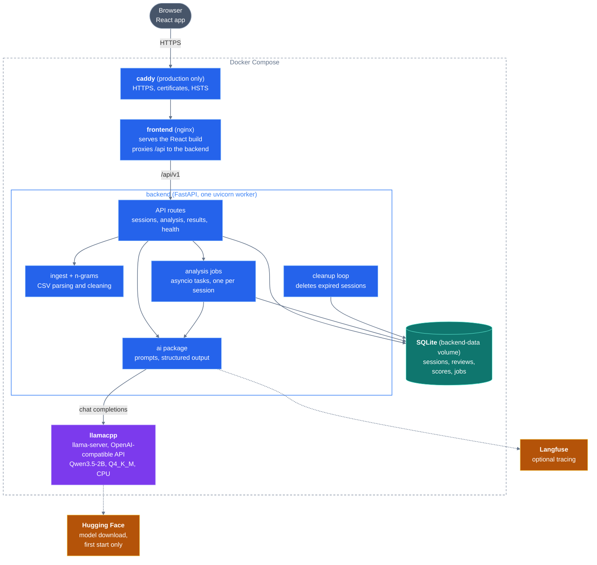
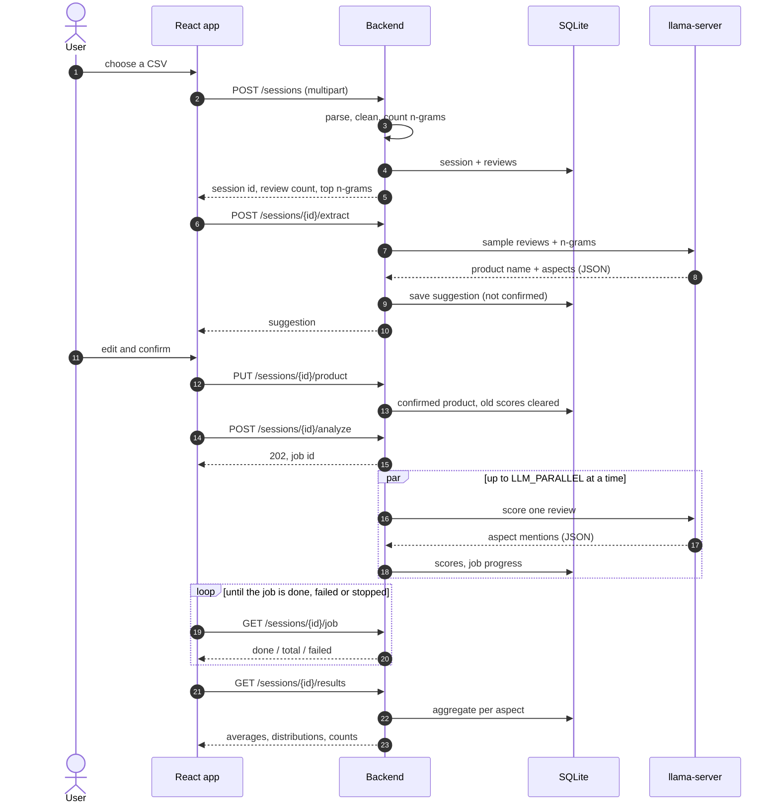

# Product Reviews Analysis

Upload customer reviews for one product and see how people feel about each part of it. Everything runs on a small open-source language model on the CPU. No paid model API is involved.

Version **0.1.0**. Live demo, when it is switched on: <https://reviews-demo.hossammostafa.ai>.

## What it is

You give the app a CSV of reviews for a single product. The model suggests which aspects of the product people talk about, such as "battery life" or "price". You check that list, and the model then scores every review from 1 to 5 on each aspect it mentions. The results come back as charts and a CSV export.

There are no accounts. Each upload is its own **session**, and the session id is the only key to its data. Sessions are deleted automatically after a few hours.

Two ideas shape the design:

- **You stay in the loop.** The model only *suggests* the product name and aspects. Nothing is scored until you confirm or edit them.
- **The model can only answer in a fixed shape.** Every model call uses structured output. When scoring, the allowed aspect names are an enum built from your confirmed list, so the model can't invent new aspects.

## Start here

| If you want to... | Read |
|---|---|
| see what the app does | [Features](#features) |
| understand how the pieces fit | [Architecture](#architecture), then [Services](#services) |
| run it on your machine | [Configuration](#configuration), then [Run locally with Docker](#run-locally-with-docker) |
| change the code | [Develop without Docker for the app](#develop-without-docker-for-the-app), then [Tests and checks](#tests-and-checks) |
| put it on a server | [Run in production](#run-in-production) |

---

## Contents

- [Features](#features)
- [Architecture](#architecture)
- [How an analysis runs](#how-an-analysis-runs)
- [Tech stack](#tech-stack)
- [Services](#services)
- [API](#api)
- [Repository layout](#repository-layout)
- [Configuration](#configuration)
- [Run locally with Docker](#run-locally-with-docker)
- [Develop without Docker for the app](#develop-without-docker-for-the-app)
- [Tests and checks](#tests-and-checks)
- [Run in production](#run-in-production)
- [License](#license)

---

## Features

### The five steps

| Step | What happens |
|---|---|
| 1. Upload | A CSV with a `text` column, up to 100 reviews. The upload is cleaned (HTML tags, URLs and control characters removed), empty rows are skipped, and the most frequent phrases (1- to 3-word n-grams) are counted. |
| 2. Extract | The model reads a fixed sample of reviews and the top phrases, then suggests the product name and up to 10 aspects. |
| 3. Review | You edit the name, and add, rename or remove aspects. Nothing runs until you confirm. |
| 4. Analyze | A background job scores every review against the confirmed aspects. A progress bar shows reviews done and failed, and you can stop the job at any time. |
| 5. Results | Each aspect gets its average score, a 1-to-5 distribution and a mention count. There's a word cloud of the top phrases and a CSV export of every score. |

### Guard rails

| Area | What it does |
|---|---|
| Sessions | The session id is a random 256-bit token, kept in the browser's `sessionStorage`. It survives a reload but not a closed tab. It never appears in the server logs: requests are logged by route template only. |
| Expiry | A background loop deletes sessions older than `SESSION_TTL_HOURS`, with their reviews, scores and jobs. A session with a job still running is kept. |
| Rate limits | Per client IP, per endpoint group: upload, extract, analyze, reads and health. nginx overwrites `X-Forwarded-For`, so the limits can't be dodged with a forged header. |
| One job per session | Starting a second analysis on the same session is refused. Changing the product details clears the earlier scores. |
| Model failures | Bad output is retried once. If the model server is unreachable several times in a row, the job stops and says why. Jobs cut off by a restart are marked as failed when the app starts again. |
| CSV export | Cells are escaped against spreadsheet formula injection. |
| Tracing | Optional Langfuse traces: one trace per session, with the extract and score calls inside it. |

---

## Architecture



How to read the diagram: a request goes from the browser through Caddy (production only) to nginx in the frontend container, which serves the React app and forwards `/api` calls to the backend. The backend keeps everything in one SQLite file and calls the model through llama.cpp's OpenAI-compatible API. The dotted lines are the only traffic that leaves the stack: the one-time model download and the optional Langfuse traces.

Four ideas explain most of the design:

1. **A small model, used narrowly.**
   - Qwen3.5-2B runs on the CPU with reasoning off and temperature 0.
   - Each call asks for one small JSON object, validated with Pydantic. The scoring schema is rebuilt for each product, so the `aspect` field only accepts the confirmed aspect names.
   - Bad output is retried, and a review that still fails is marked *failed* without stopping the job.

2. **One process owns the jobs.**
   - Analysis jobs are `asyncio` tasks inside the single uvicorn worker. An in-process lock makes "check for a running job, then start one" atomic.
   - Review scoring runs in parallel, limited to as many requests as llama-server has slots (`LLM_PARALLEL`).
   - This is why the backend runs with exactly one worker.

3. **The database is a single SQLite file.**
   - Four tables: `sessions`, `reviews`, `scores`, `jobs`. Everything hangs off a session with `ON DELETE CASCADE`, so deleting a session removes all its data.
   - Alembic migrations run every time the container starts.

4. **Each container only reaches what it needs.**
   - The frontend can't reach llama.cpp. Caddy can only reach the frontend.
   - The network between the frontend and the backend has no internet access, and nginx refuses requests coming from the backend's side of it.
   - The backend container runs as a non-root user.

---

## How an analysis runs



---

## Tech stack

| Layer | Technologies |
|---|---|
| Model | Qwen3.5-2B (GGUF, Q4_K_M) served by [llama.cpp](https://github.com/ggml-org/llama.cpp)'s `llama-server` on the CPU, through its OpenAI-compatible API |
| Backend | Python 3.14, FastAPI, SQLAlchemy 2 (async, aiosqlite) + Alembic, Pydantic settings, OpenAI Python SDK with structured outputs, SlowAPI for rate limits, Langfuse for optional tracing |
| Frontend | React 19, TypeScript, Vite, Recharts (loaded lazily), served by nginx |
| Data | SQLite on a Docker volume |
| Tooling | uv workspace (one lockfile), npm, ruff, ESLint, Prettier, tsc, pytest + httpx, Vitest + Testing Library |
| Delivery | Docker Compose, Caddy (automatic Let's Encrypt HTTPS), GitHub Actions CI |

---

## Services

All services are defined in [`compose.yml`](compose.yml).

### What runs

| Service | Purpose | Port |
|---|---|---|
| `frontend` | the web app; proxies `/api/` to the backend | `FRONTEND_PORT` (default `80`); not published in production |
| `backend` | the API and the analysis jobs; runs the migrations on start | internal `11696` |
| `llamacpp` | the language model; downloads it on first start | internal `8000` |
| `caddy` | **production only**: HTTPS in front of the frontend; gets and renews its own certificate | `80`, `443` (TCP and UDP) |

### Volumes

| Volume | Holds |
|---|---|
| `huggingface-cache` | the downloaded model. Keep it, or every fresh start downloads the model again. |
| `backend-data` | the SQLite database |
| `backend-logs` | the backend's log files |
| `caddy-data` | production only: the certificates |
| `caddy-config` | production only: Caddy's config state |

### Networks

| Network | Members | Notes |
|---|---|---|
| `public` | Caddy, frontend | the edge |
| `app` | frontend, backend | internal: no route to the internet |
| `llm` | backend, llamacpp | llama.cpp needs the internet for the model download; the backend uses it for Langfuse |

### Compose files

| File | Use |
|---|---|
| `compose.yml` | the base stack, for both local and production |
| `compose.dev.yml` | development overlay: publishes llama.cpp (`127.0.0.1:8000`) and the backend (`127.0.0.1:11696`) to your machine only |
| `compose.prod.yml` | production overlay: adds Caddy and stops publishing the frontend port |

---

## API

All routes live under `/api/v1`. The session id in the path is the access token.

| Method and path | What it does |
|---|---|
| `GET /health` | liveness check, used by the Docker healthcheck |
| `GET /config` | upload limits and the time estimate per review, shown before a file is picked |
| `POST /sessions` | upload the CSV and create a session |
| `GET /sessions/{id}` | the session's current state, so the page can resume after a reload |
| `POST /sessions/{id}/extract` | ask the model for the product name and aspects |
| `PUT /sessions/{id}/product` | confirm the product details, edited or not |
| `POST /sessions/{id}/analyze` | start the scoring job (`202 Accepted`) |
| `GET /sessions/{id}/job` | job progress |
| `POST /sessions/{id}/job/stop` | stop the running job |
| `GET /sessions/{id}/results` | per-aspect averages, distributions and counts |
| `GET /sessions/{id}/export.csv` | every score, one row per review |

With the dev overlay running, the interactive docs are at <http://localhost:11696/docs>.

---

## Repository layout

```
.
├── backend/
│   ├── app/
│   │   ├── ai/             prompts, structured-output schemas, extract and score calls
│   │   ├── api/            FastAPI routes and dependencies
│   │   ├── core/           settings and the rate limiter
│   │   ├── database/       SQLAlchemy models and client
│   │   ├── ingest.py       CSV parsing, cleaning and sampling
│   │   ├── ngrams.py       frequent-phrase counting
│   │   ├── jobs.py         the analysis job: start, run, stop, recover
│   │   ├── aggregate.py    results and the CSV export
│   │   ├── cleanup.py      expired-session deletion
│   │   ├── tracing.py      optional Langfuse tracing
│   │   └── main.py         app setup and startup and shutdown
│   ├── migrations/         Alembic migrations
│   ├── scripts/            sample-data generator and a manual check against the model
│   ├── tests/
│   ├── Dockerfile
│   └── entrypoint.sh       migrate, then start uvicorn
├── frontend/
│   ├── src/
│   │   ├── components/     one component per step, plus charts and the word cloud
│   │   ├── hooks/          extraction and job polling
│   │   └── api.ts          typed client for the backend
│   ├── nginx.conf
│   └── Dockerfile
├── compose.yml / compose.dev.yml / compose.prod.yml
├── Caddyfile               production HTTPS; reads DOMAIN and LETSENCRYPT_EMAIL
└── pyproject.toml / uv.lock   uv workspace root
```

---

## Configuration

All configuration comes from environment variables in a `.env` file at the repo root. Start from the example:

```bash
cp .env.example .env
```

`.env` is git-ignored. **Never commit it.** Every setting has a working default, so the copied file runs as it is.

### Model and llama.cpp

| Variable | Default | Notes |
|---|---|---|
| `OPENAI_API_BASE` | `http://localhost:8000/v1` | For running the backend with `uv run`. Inside Docker, Compose always sets it to `http://llamacpp:8000/v1`. |
| `OPENAI_API_KEY` | `not-needed` | llama-server doesn't check it, but the SDK needs a value. |
| `OPENAI_MODEL_NAME` | `local` | |
| `OPENAI_TEMPERATURE`, `OPENAI_SEED` | `0.0`, `42` | for repeatable answers |
| `OPENAI_MAX_COMPLETION_TOKENS` | `384` | |
| `OPENAI_TIMEOUT_SECONDS`, `OPENAI_MAX_RETRIES` | `60`, `1` | per model call |
| `LLM_PARALLEL` | `4` | llama-server slots, and the number of reviews scored at once. Compose sets both from this one value. |
| `LLM_THREADS` | `4` | CPU threads for llama-server |
| `PERFORMANCE_OPENAI_CONCURRENT_REQUESTS` | `4` | Only read outside Docker. Keep it equal to `LLM_PARALLEL`. |

The 16384-token context is shared between the slots, so with 4 slots each request gets 4096 tokens. If you raise `LLM_PARALLEL`, raise `--ctx-size` in `compose.yml` in proportion.

### Sessions and analysis

| Variable | Default | Notes |
|---|---|---|
| `SESSION_TTL_HOURS` | `6` | how long a session lives |
| `SESSION_MAX_UPLOAD_MB` | `2` | must stay below nginx's `client_max_body_size` (12 MB) |
| `SESSION_MAX_ROWS` | `100` | reviews per upload |
| `SESSION_CLEANUP_INTERVAL_MINUTES` | `30` | how often expired sessions are deleted |
| `ANALYSIS_REVIEW_MAX_CHARS` | `1000` | reviews are cut to this length before scoring |
| `ANALYSIS_NGRAM_MAX_N`, `ANALYSIS_NGRAM_TOP_K` | `3`, `100` | longest phrase counted, and how many are kept |
| `ANALYSIS_EXTRACTION_SAMPLE_SIZE`, `ANALYSIS_EXTRACTION_SAMPLE_CHARS` | `20`, `300` | the review sample the model reads for extraction |
| `ANALYSIS_SCORING_RETRIES` | `1` | retries for a model answer that doesn't validate |
| `ANALYSIS_ESTIMATED_SECONDS_PER_REVIEW` | `2.5` | only used for the time estimate shown to the user |

### Rate limits (requests per minute, per client IP)

| Variable | Default |
|---|---|
| `RATE_LIMIT_UPLOAD` | `5` |
| `RATE_LIMIT_EXTRACT` | `4` |
| `RATE_LIMIT_ANALYZE` | `3` |
| `RATE_LIMIT_READ` | `120` (job polling, results, export) |
| `RATE_LIMIT_HEALTH` | `60` |

### Application, storage and tracing

| Variable | Default | Notes |
|---|---|---|
| `APPLICATION_NAME`, `APPLICATION_VERSION` | `reviews-analysis`, `0.1.0` | the version also tags the Docker images |
| `APPLICATION_LOG_LEVEL` | `INFO` | |
| `DATABASE_PATH` | `./data/reviews-analysis-database.db` | relative to `backend/` |
| `FRONTEND_PORT` | `80` | host port for the app when running locally |
| `LANGFUSE_PUBLIC_KEY`, `LANGFUSE_SECRET_KEY` | empty | tracing turns on when both are set |
| `LANGFUSE_HOST` | `https://cloud.langfuse.com` | |

### Production

| Variable | Notes |
|---|---|
| `DOMAIN` | the public host name, for example `reviews.example.com` |
| `LETSENCRYPT_EMAIL` | the address for certificate expiry notices |

`compose.prod.yml` refuses to start without them.

---

## Run locally with Docker

**You need:** Docker with the Compose plugin. The defaults assume 4 CPU cores.

### Step 1. Configure

```bash
cp .env.example .env
```

### Step 2. Start the stack

```bash
docker compose up -d --build
```

- On the first start llama.cpp downloads the model, which takes a few minutes. The backend waits until llama.cpp is healthy, and the frontend waits for the backend.
- The backend runs the database migrations on start.
- When it's up, open <http://localhost>.

### Step 3. Try it

You need a CSV with a `text` column. To generate one with known answers (synthetic headphone reviews):

```bash
uv run --directory backend python -m scripts.make_sample_reviews
```

It writes `backend/data/sample_reviews.csv`. Upload it, check the suggested aspects, and start the analysis.

### Useful commands

```bash
docker compose logs -f backend    # follow the backend logs
docker compose down               # stop, keep the data and the model
docker compose down -v            # stop and delete all volumes, including the downloaded model
```

---

## Develop without Docker for the app

In this setup llama.cpp runs in Docker, and the backend and frontend run on your machine with hot reload.

**You need:** [uv](https://docs.astral.sh/uv/) (it installs Python 3.14 for you), Node.js 22 and Docker.

### One-time setup

```bash
uv sync
(cd frontend && npm ci)
cp .env.example .env              # its OPENAI_API_BASE points at localhost:8000
```

### Start llama.cpp (http://localhost:8000)

```bash
docker compose -f compose.yml -f compose.dev.yml up -d llamacpp
```

### Run the backend (http://localhost:11696)

The settings don't read `.env` on their own, so pass it to `uv run`:

```bash
cd backend
uv run --env-file ../.env alembic upgrade head
uv run --env-file ../.env uvicorn app.main:app --reload --port 11696
```

### Run the frontend (http://localhost:5173)

Vite forwards `/api` to port 11696.

```bash
cd frontend && npm run dev
```

### Check the model on its own

`scripts/smoke_llm.py` runs extraction and scoring against llama-server without the API. If the CSV came from `make_sample_reviews`, it also compares the scores with the expected answers:

```bash
uv run --directory backend --env-file ../.env python -m scripts.smoke_llm \
    data/sample_reviews.csv --base-url http://localhost:8000/v1 --limit 30
```

### Add a migration after a model change

```bash
cd backend
uv run --env-file ../.env alembic revision --autogenerate -m "describe the change"
```

---

## Tests and checks

The tests never call a real model: the backend tests use fakes of the OpenAI client, and the frontend tests use a fake backend.

| Command | What it does |
|---|---|
| `cd backend && uv run pytest` | backend tests: ingest, n-grams, schemas, model wiring, jobs, API, database, tracing |
| `uv run ruff check .` / `uv run ruff format --check .` | Python lint and format check |
| `cd frontend && npm run lint` | ESLint |
| `cd frontend && npm test` | Vitest and Testing Library |
| `cd frontend && npm run build` | type check (`tsc -b`) and production build |

CI ([`.github/workflows/ci.yml`](.github/workflows/ci.yml)) runs the backend tests, and the frontend lint, tests and build, on every push to `main`.

---

## Run in production

The app runs as one Compose stack on a single VM, with Caddy in front for HTTPS.

### Step 1. VM

4 vCPU and 8 GB RAM is comfortable. The model runs on the CPU, so more cores make the analysis faster. Install Docker with the Compose plugin and open ports 22, 80 and 443 only.

### Step 2. DNS

Point an `A` record (and an `AAAA` record for IPv6) for your domain at the VM.

### Step 3. Configure

Clone the repo, run `cp .env.example .env`, and set:

- `DOMAIN` and `LETSENCRYPT_EMAIL`,
- `LLM_THREADS` and `LLM_PARALLEL` to match the VM's cores,
- the Langfuse keys, if you want tracing.

### Step 4. Start

```bash
docker compose -f compose.yml -f compose.prod.yml up -d --build
```

Caddy is configured in [`Caddyfile`](Caddyfile). On its first start it gets a Let's Encrypt certificate for `DOMAIN`, and it renews it on its own. HTTP redirects to HTTPS, and responses carry HSTS. The site is public: anyone with the link can use it, and the rate limits are what protect the model server.

### Operating it

```bash
P="docker compose -f compose.yml -f compose.prod.yml"
$P logs -f backend          # logs
git pull && $P up -d --build   # update; migrations run on start
```

- **What is exposed:** only Caddy is published. The frontend, backend and llama.cpp have no host ports.
- **Reboots:** every service restarts on its own.
- **Backups:** there's not much to keep. Sessions expire after a few hours, so the `backend-data` volume only holds short-lived data. Keep `huggingface-cache` so restarts don't download the model again.
- **Link previews:** the Open Graph tags in [`frontend/index.html`](frontend/index.html) use the demo's absolute URL. Change them if you deploy under another domain.

---

## License

Released under the [MIT License](LICENSE).
